# GitLab Monitor - K9s for GitLab

A K9s-style Terminal User Interface for GitLab. Real-time pipeline monitoring, cross-project merge request triage, a per-project dashboard, commit and tag browsing, and quick actions (merge an MR, create a tag, roll a deploy back to a previous tag) — all without leaving the terminal.

<p align="center">
  <a href="glmon-assets/Pipeline-list.png">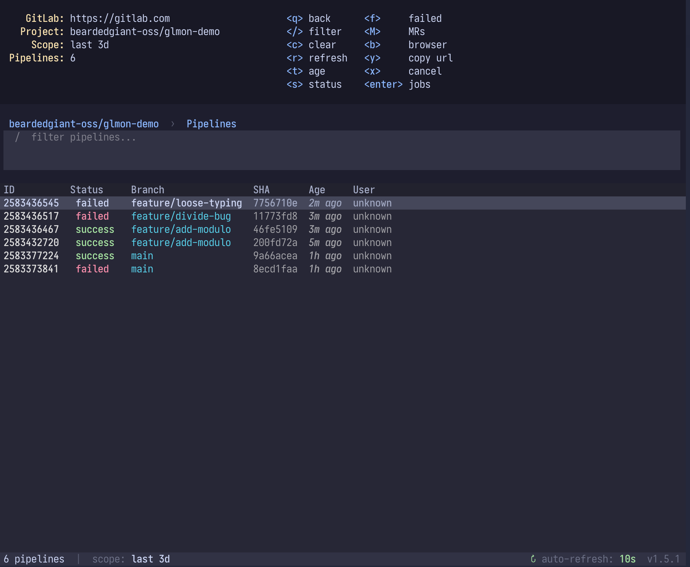</a>
</p>

## Installation

### Homebrew (recommended)

```bash
brew tap bearded-giant/tap
brew install gitlab-monitor
```

### From source (development)

```bash
cd gitlab-monitor
make install        # release version from pyproject.toml
make install-dev    # bakes a dev build, version becomes 1.5.15.dev0+<7sha>[.dirty]
make dev            # editable install (-e), source changes auto-apply
make version        # print the dev version that install-dev would use
make test           # run the test suite (uv pulls pytest in on the fly)
```

`make install-dev` rewrites the version in `pyproject.toml` temporarily so the installed package carries a sha-tagged dev version. `glmon --version` confirms which build is running. The LoadingScreen splash also shows the version.

### Debug logging (dev builds)

Dev builds (any version containing `.dev`) automatically write to `/tmp/glmon-debug.log`. Useful for verifying which screen mounted, when loading indicators fire, and any silent exceptions in the status-bar update path.

```bash
make install-dev
glmon            # use normally
tail -f /tmp/glmon-debug.log
```

- Override path: `GLMON_DEBUG_LOG=/some/other/path glmon`
- Disable on a dev build: `GLMON_DEBUG_LOG=off glmon`
- Release builds (e.g. `1.5.15`) never log regardless of env

## Configuration

### Required Environment Variables
```bash
export GITLAB_URL=https://gitlab.example.com
export GITLAB_TOKEN=your_personal_access_token
```

### Optional Environment Variables
```bash
export GITLAB_PROJECT=group/project         # default project (still lands on My Work; -p skips it)
export GLMON_REVIEWS_DIR=~/dev/reviews      # where the Reviews module keeps local review files
export GLMON_REVIEWS_ENABLED=0              # kill switch for the auto-review poller (0/false/off)
```

#### Refresh Tuning (per-view, optional)
Override default refresh cadences for each view. Useful when GitLab traces are large and the log view auto-refresh appears stalled — bump `GLMON_FETCH_TIMEOUT` and/or `GLMON_TRACE_REFRESH_INTERVAL` so the trace GET completes before the next tick.

```bash
export GLMON_PIPELINE_REFRESH_INTERVAL=120  # list + MR screens refresh (default: 120s)
export GLMON_JOB_REFRESH_INTERVAL=120       # job list refresh (default: 120s)
export GLMON_LOG_REFRESH_INTERVAL=5         # log view: status/duration meta tick (default: 5s)
export GLMON_TRACE_REFRESH_INTERVAL=2       # log view: trace fetch cadence (default: 2s)
export GLMON_FETCH_TIMEOUT=30               # per-fetch timeout in log view (default: 30s)
export GLMON_IDLE_PAUSE_MINUTES=15          # pause all auto-refresh after this long with no input; 0 disables (default: 15)
```

Only the screen you're looking at polls. Screens further back in the stack pause until you return to them. After `GLMON_IDLE_PAUSE_MINUTES` without a key or mouse event, auto-refresh stops and any key picks it back up, so a glmon left open overnight doesn't keep hitting GitLab.

The log view splits refresh into a meta tick (job status + duration via a small JSON GET) and a trace tick that asks GitLab only for the log bytes it hasn't seen yet (an HTTP Range request). Both stay cheap, so the trace tick can run every couple of seconds without piling up multi-MB downloads.

### Config File (Optional)
Configuration can also be stored in `~/.config/gitlab-monitor/config.json`:
```json
{
  "gitlab_url": "https://gitlab.example.com",
  "project_path": "group/project",
  "reviews": {
    "enabled": true,
    "dir": "~/dev/reviews",
    "model": "opus",
    "include_drafts": false,
    "settle_minutes": 10
  }
}
```

The `reviews` block drives the Reviews module and its poller (see view 13). Every key is optional and falls back to the value shown. An optional `jira` block drives `glmon-jirad` (see [Jira Sync](#jira-sync)).

Note: Never put the token in `config.json`. Use the `GITLAB_TOKEN` environment variable, or for non-interactive runs (the Reviews poller under launchd) a `~/.config/gitlab-monitor/token` file with mode 600.

## Quick Start

After installation, the tool is available as `gitlab-monitor` or `glmon` (short alias):

```bash
glmon                                # lands on My Work (cross-project home)
glmon -p group/subgroup/project      # skip the home, jump straight into a project
glmon --days 7                       # default pipeline window: 7 days (default: 3)
glmon -p group/project --days 30     # combined
glmon -p group/project -B            # pre-filter pipelines to the CWD git branch
```

By default `glmon` opens **My Work** — your starred repos, your open MRs grouped by repository, and the tag deploys you pushed, pulled across every project. Press `m` (or `tab`) anywhere to open the module switcher and jump to the Project Hub, MRs, Pipelines, Tags, or Reviews. Pass `-p` to skip the home entirely and drop straight into a project's pipeline list. `GITLAB_PROJECT` only sets a default project; it doesn't skip the home.

### CLI Arguments

| Flag | Description |
|------|-------------|
| `-p, --project PATH` | Jump directly into `group/project` (skips the home). Overrides `GITLAB_PROJECT`. |
| `--days N` | Default pipeline age window in days. Default: 3. Cycle in-app with `t`. |
| `-b, --branch NAME` | Pre-fill the pipeline filter with this branch (clearable in the UI). |
| `-B, --cwd-branch` | Pre-fill the pipeline filter with the current git branch detected from the working directory. |

## Features

1. **My Work home** -- cross-project landing screen: your starred repos, your open MRs grouped by repository, and your latest tag deploy per repo, gathered from every project at once
2. **Module switcher** -- `m`/`tab` from any home screen to jump between My Work, Project Hub, MRs, Pipelines, Tags, and Reviews; number keys `1`-`6` jump directly
3. **Project Hub** -- per-project dashboard with MRs and pipelines on top, commits and tags below; `[`/`]` to cycle, capital letters to open a full view
4. **Project picker with favorites** -- star projects you care about; favorites load first (fast), toggle to full list on demand
5. **Pipeline age window** -- default 3 days (big speedup on busy projects); cycle `3d / 7d / 30d / all` with `t`
6. **Real-time auto-refresh** -- lists and MR screens refresh every 2 minutes (`r` refreshes now), a running job's log every few seconds; only the visible screen polls, and polling pauses after 15 idle minutes
7. **Multi-level drill-down** -- Projects -> Pipelines -> Jobs -> Logs, including child/downstream pipelines
8. **Merge request triage** -- cross-project and per-project MR lists, full detail view, approval state, per-MR local notes, markdown export
9. **MR quick actions** -- merge, toggle auto-merge (merge-when-pipeline-succeeds), approve, close, assign, and comment straight from the detail view
10. **Tag management** -- list tags with per-tag pipeline status; create + push a tag (`t`), roll a deploy back by re-running an older tag's pipeline (`R`), or open a revert MR for a tag's commit (`V`)
11. **Commit browser** -- browse a project's default-branch commits, drill into commit detail and its pipeline
12. **Filtering** -- K9s-style filter bar for branch/user, a status cycle (running / pending), and a failed-only toggle
13. **Failure extraction** -- automatically extracts and highlights test failures; failed jobs flagged in red
14. **Browser + clipboard** -- `b` opens the current selection in GitLab, `y` copies its URL or log output
15. **Job detail info bar** -- live status and duration while viewing job logs
16. **Assigned reviews** -- every open MR where you are a reviewer, across all projects, with markers for reviewed / stale / approved; an optional launchd poller pre-runs an adversarial AI review into a local markdown file and notifies you when a reviewed MR gets new commits. Nothing is ever posted back to GitLab.

## Views

### 1. My Work (home)

The default landing screen. Three panels: your **Favorites** (starred repos), **My Open MRs** (every MR you authored, across all projects, grouped by repository), and **My Tag Deploys** (the latest tag pipeline you pushed in each favorite, running ones pinned on top). Cycle panels with `[`/`]`, `enter` to open the highlighted repo (into its Project Hub) or MR (into detail). `M` jumps to the full MRs list, `P` to your pipelines. This is module `1`; it always opens here (no last-view restore). `esc` or `Ctrl+c` quits the app; `q` is back-only and a no-op on the home.

### 2. Module Switcher

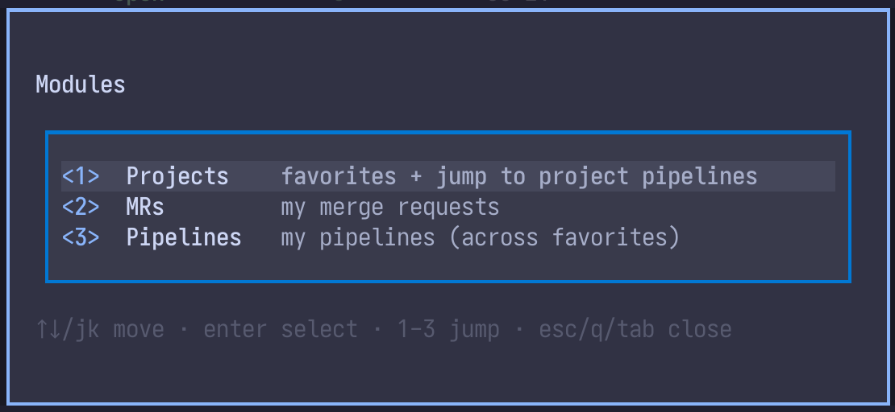

Press `m` or `tab` from any home screen to switch modules. Six of them:

| # | Module | What |
|---|--------|------|
| 1 | My Work | favorites, my open MRs, tag deploys |
| 2 | Project Hub | pick a project, then its MRs, pipelines, commits, tags |
| 3 | MRs | my merge requests |
| 4 | Pipelines | my pipelines across favorites |
| 5 | Tags | pick a project, then its tags + create/push/rollback |
| 6 | Reviews | MRs where I'm a reviewer + local AI reviews |

Navigate with `↑↓` or `j/k`, `enter` to confirm. Number keys `1`-`6` jump directly. `esc`/`q`/`tab` closes.

### 3. Project Picker (Project Hub and Tags modules)

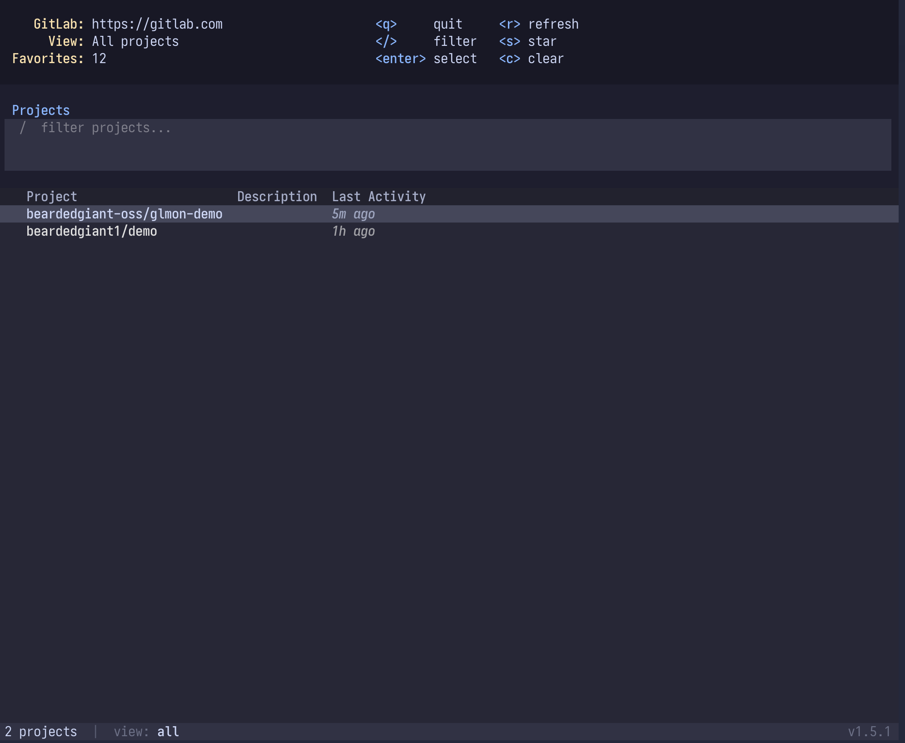

Defaults to **Favorites** view if any projects are starred (fast, no full project listing). Press `a` to toggle to **All** projects (sorted by last activity, favorites pinned to top). A leading `*` column marks starred projects. Type to filter, Enter to select, `s` to star/unstar.

Favorites persist to `~/.config/gitlab-monitor/favorites.json`.

### 4. Project Hub

The per-project dashboard (module `2`). One screen with four live panels. Open **MRs** fill the top row and recent **Pipelines** the second, both full width. Recent **Commits** and latest **Tags** share the bottom row at 70/30, stacking when the terminal is narrow. The MR panel has focus on open. The header carries the project's commit/MR/tag/pipeline counts.

Cycle the focused panel with `[` and `]`, `enter` opens the highlighted row, and `t` cycles the commit window (`1d / 3d / 7d`). Capital letters open a panel as its own full view: `C` commits, `M` MRs, `P` pipelines, `T` tags.

### 5. Pipeline List View


Shows recent pipelines with ID, status (color-coded), branch, creation time, and commit SHA. Defaults to the last 3 days to keep load fast on busy projects. Press `t` to cycle window: `3d -> 7d -> 30d -> all`. Current window shown in breadcrumb. `M` jumps to this project's MRs, `P` to your pipelines.

K9s-style filter bar — press `/` to filter by branch or user:

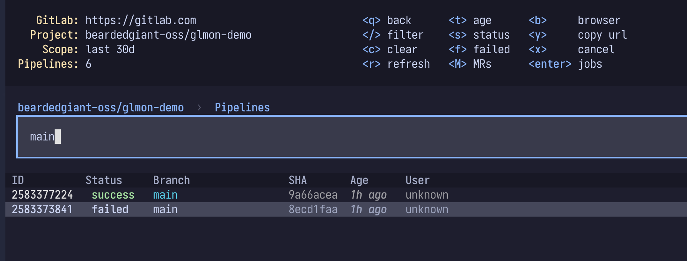

`s` cycles a status filter (all / running / pending) and `f` toggles failed-only, so you can narrow the list without typing a filter:

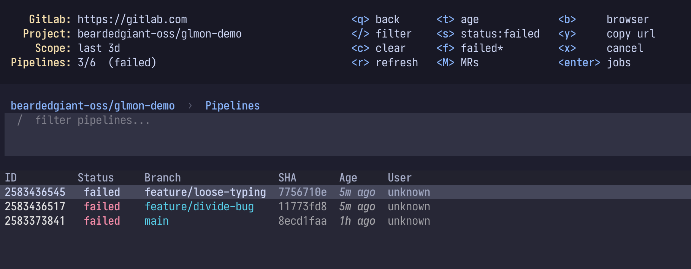

### 6. Job List View

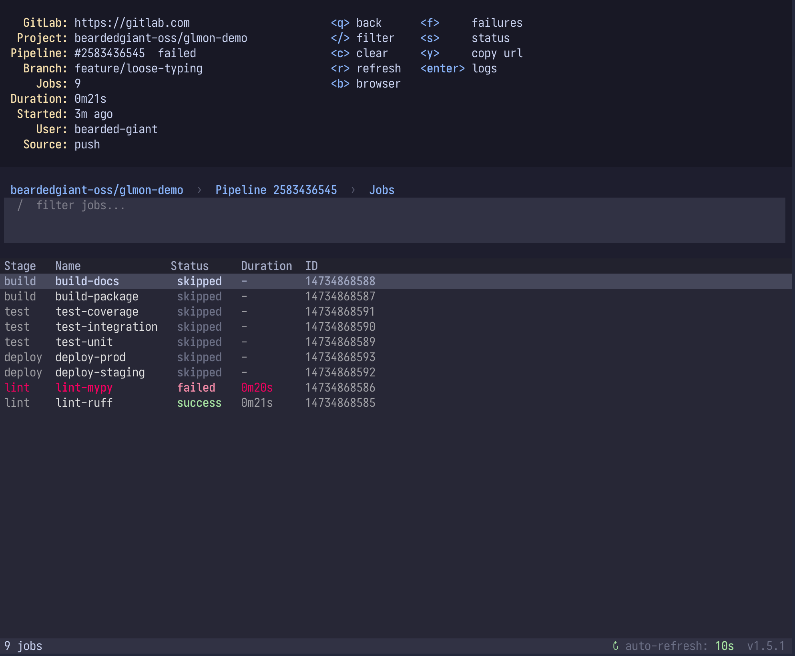

Shows all jobs in a pipeline grouped by stage (build, test, deploy, cleanup) with color-coded status and duration. Child/downstream pipelines show up as bridge rows; `enter` on one drills into that pipeline, even across projects.

### 7. Job Detail View

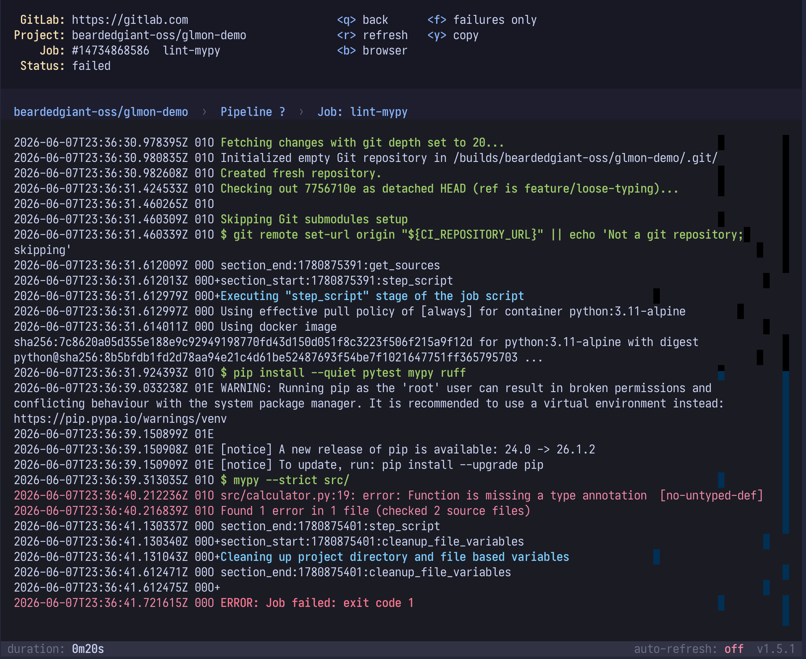

Shows job logs with a live status/duration info bar, failure summary at top (for failed jobs), full trace, and error line highlighting. Log output streams incrementally as the job runs.

### 8. Failed Jobs Summary View
Press `f` in the job list for a quick view of the pipeline's failed jobs with their extracted failure messages (first 10 per job). `y` copies the lot. Failures inside child pipelines aren't listed here; drill into the bridge row instead.

### 9. Merge Requests

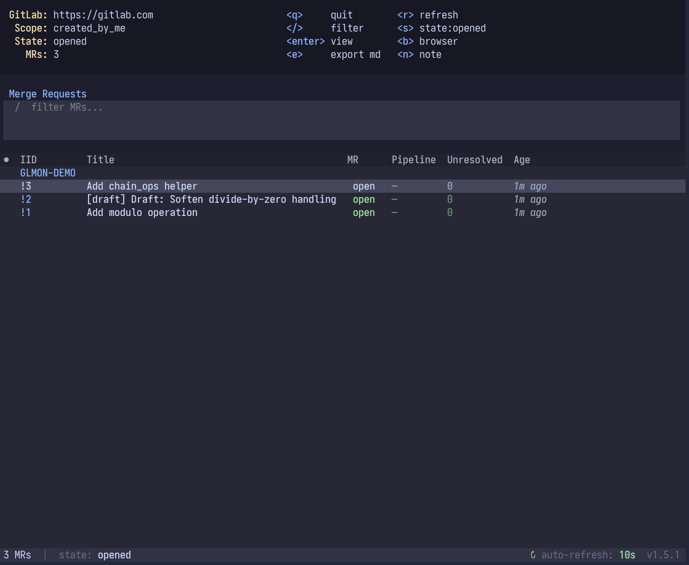

Two flavors: **My MRs** (module `3`) is a cross-project view of the MRs you authored, grouped by repository; **Project MRs** (reached with `M` from a project's pipeline list) scopes to one project. Both support `/` filter, `s` to cycle state (opened / merged / closed / all), `A` to toggle auto-merge, `u` to assign the highlighted MR (same user lookup as MR detail), and `b`/`y` for browser/copy. My MRs adds more: `w` cycles the merged/closed window (1d / 7d / 10d), per-MR local notes show a yellow `●` glyph, `e` exports the list to markdown, and `M` merges without opening the MR.

### 10. Merge Request Detail

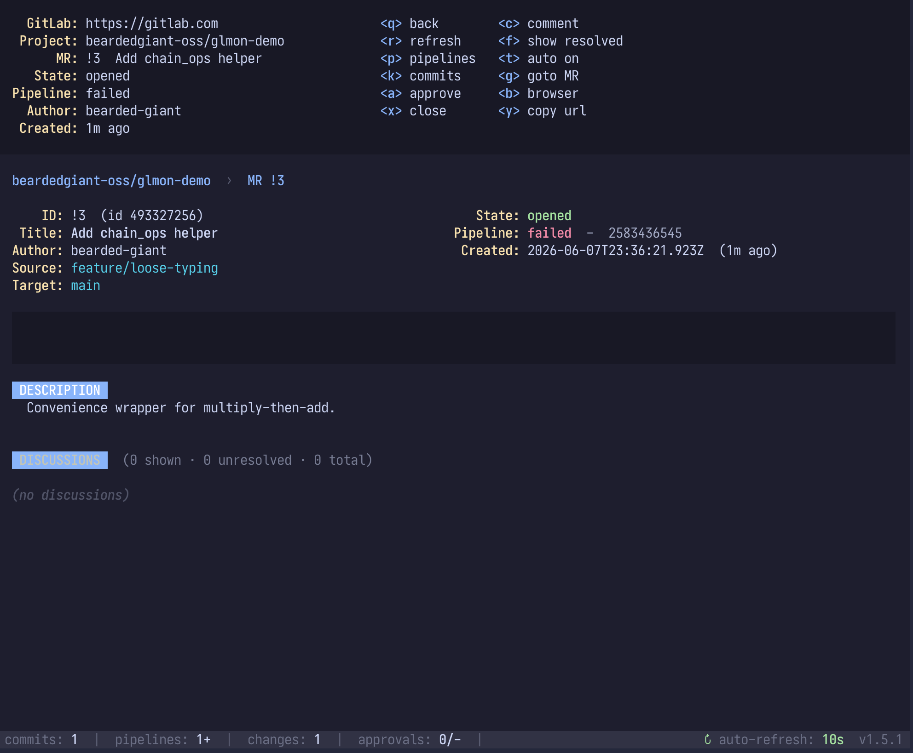

Title, description, author, source/target branches, pipeline status, and approval state. Drill into pipelines (`p`) or commits (`k`) from here. Quick actions: merge (`M`), approve (`a`), and close (`x`) each ask for a confirm first; assign (`u`) opens a filterable list of the project's users, cached locally for a day (`ctrl+r` in the list reloads it); toggle auto-merge / merge-when-pipeline-succeeds (`A`) applies right away; comment (`c`) opens a multi-line box (`ctrl+s` posts, `esc` cancels). Discussions render as markdown: headings, lists, links, code blocks, and `diff`/`suggestion` blocks in red and green. HTML from bots like Greptile is converted, and inline comments show their `file:line`. `<details>` sections start collapsed the way GitLab shows them; `e` expands or collapses them all. `f` toggles resolved discussions, `t` toggles the 2-minute auto-refresh, and `g` jumps to another MR by number. When a local review file exists for the MR, a `Review:` line sits between approvals and the description showing current or stale, the review time, unread, and whether it has been posted; `v` opens it in a modal (`q` closes). `R` runs an adversarial review for this MR now, whether or not one exists; the section updates on the next refresh.

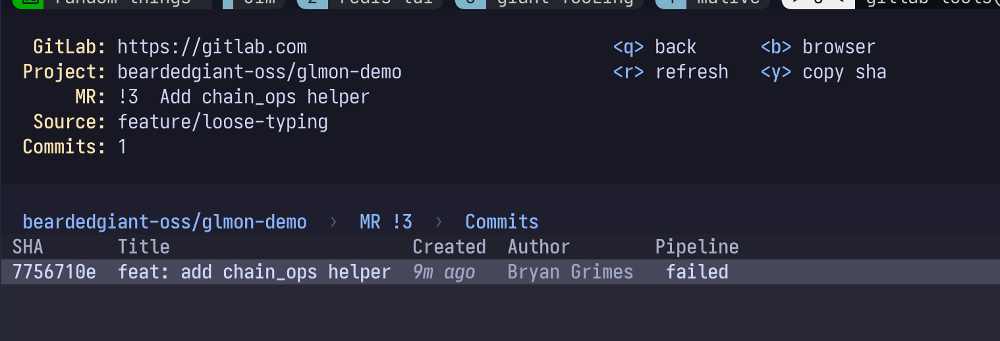

### 11. MR Notes

Local-only notes per MR (`~/.config/gitlab-monitor/mr_notes.json`). Press `n` from the MR list:

| Create | Edit |
|--------|------|
| 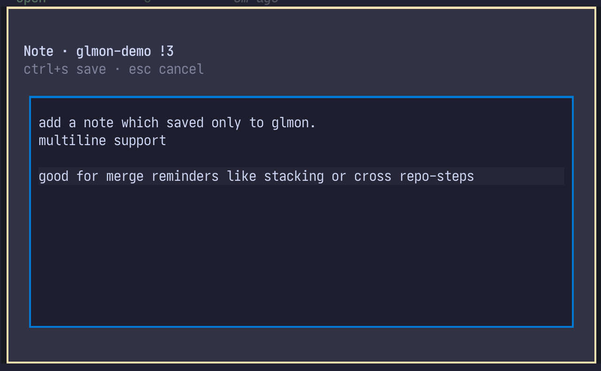 | 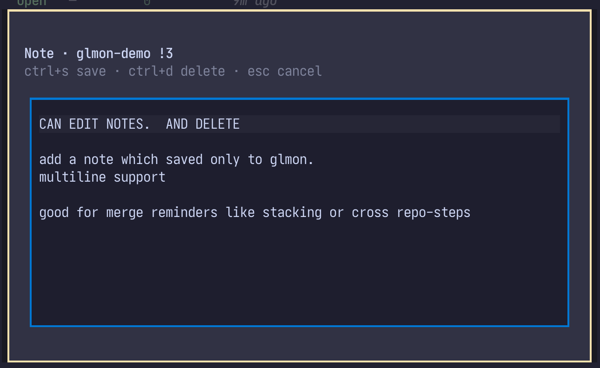 |

Notes survive across runs and inline into the markdown export as blockquotes.

### 12. Tags

The Tags view (module `5`) lists a project's tags with date, target commit, per-tag pipeline status, and message. `enter` opens the pipelines filtered to that tag. Three actions:

| Key | Action |
|-----|--------|
| `t` | Create + push a new tag (suggests the next minor version) on the default branch |
| `R` | Run the selected tag's pipeline — re-run a tag, or roll a deploy back by running an older tag (deploys on tag run automatically) |
| `V` | Open a merge request that reverts the selected tag's commit on the default branch |

Rolling back a deploy is two steps: put the cursor on the last known-good tag and press `R` to redeploy it, then put the cursor on the bad tag and press `V` to open the revert MR that realigns source. Both prompt before hitting the API. The revert MR is created entirely through the GitLab API (a `revert-<tag>` branch off the default branch, the revert commit pushed to it, and the MR opened) — no local checkout needed; it opens in your browser on success.

### 13. Reviews

Module `6`. Lists every open MR where you are a reviewer, grouped by repository, with two marker columns. `Rv` shows the local review state and `Ok` shows whether you have approved the MR.

| `Rv` | Meaning |
|------|---------|
| blank | no local review yet |
| `●` | reviewed, and the review matches the MR's current head commit (bold until you open it) |
| `◐` | reviewed, but the author has pushed since; stale |
| `○` | you approved this before any review existed; the sha is pinned so a later push is still caught |

Keys: `v` opens the review file in a markdown modal (`q` closes, `y` copies the review, `c` posts it as an MR comment after a confirm, `R` re-runs the review), `R` runs a review for the highlighted MR right now, `T` runs one poller tick right now, `P` toggles the auto-review kill switch, `a` approves (confirm), `enter` opens MR detail, plus the usual `/`, `b`, `y`, `n`, `p`.

#### The poller

`glmon-reviewd` is a one-shot command: it lists your assigned MRs, skips drafts and anything pushed to in the last `settle_minutes`, and for each MR with no review file (or a review file whose sha no longer matches the head) it runs

```
claude -p "/grill <mr url>" --model <reviews.model> --output-format json
```

and writes the result to `<reviews.dir>/<project>/<iid>-<title>.md` with frontmatter (`sha`, `previous_shas`, `cost_usd`, `session_id`, `approved_by_me`, `status`). Re-reviews get a hint line naming the previously reviewed sha so the review leads with what changed. A macOS notification fires per review; the title says `New review`, `UPDATED, re-reviewed`, or `APPROVED MR CHANGED` when an MR you had approved moved under you. The prompt runs the `grill` skill's read-only MR mode, which seeds from Greptile's threads on the MR and checks the description's claims against the code. The review never posts to GitLab: MR mode never writes, the poller refuses any prompt containing `--post`, and the system prompt forbids GitLab writes.

MRs you have already approved but never reviewed get a zero-cost baseline file (`○`) instead of an initial review, so their sha is tracked without spending anything.

Run it by hand:

```bash
glmon-reviewd --dry-run          # print the queue with reasons, run nothing
glmon-reviewd --once             # one tick (the default)
glmon-reviewd --mr group/project!123   # review one MR now, ignoring the filters
glmon-reviewd --status
```

Schedule it with launchd (every 5 minutes, one instance at a time):

```bash
cp launchd/com.bryan.glmon-reviewd.plist ~/Library/LaunchAgents/
launchctl load ~/Library/LaunchAgents/com.bryan.glmon-reviewd.plist
launchctl list | grep glmon
tail -f ~/.cache/glmon/reviewd.err
```

launchd starts the poller with a bare environment, so `GITLAB_TOKEN` from your shell is not there. Put the token in a file only you can read and the poller picks it up when the env var is absent:

```bash
printf '%s' "$GITLAB_TOKEN" > ~/.config/gitlab-monitor/token && chmod 600 ~/.config/gitlab-monitor/token
```

`glab` (used inside the review) keeps its own token in `~/.config/glab-cli/config.yml`, so it needs nothing extra. Edit the path and username in the plist if they differ.

Cost control. Each opus review runs a few minutes and about a dollar and a quarter on a small diff; re-reviews are a little cheaper. There is no daily cap. Two switches:

```bash
glmon-reviewd --disable          # soft: poller still runs on schedule but exits immediately; R in the TUI still works
glmon-reviewd --enable
launchctl unload ~/Library/LaunchAgents/com.bryan.glmon-reviewd.plist   # hard: stop the schedule
```

`P` in the Reviews view flips the same soft switch, and the header shows `Auto-review ON/OFF`.

### 14. Commit Browser

Browse commits on a project's default branch, reached from the Project Hub's Commits panel (`C`). Columns show author, message, and pipeline status; `t` cycles the time window. `enter` opens commit detail — changed files and stats — and `p` jumps to that commit's pipeline. `k` on an MR opens a separate list of that MR's own commits, where `enter` opens the commit in your browser.

### 15. Confirmations

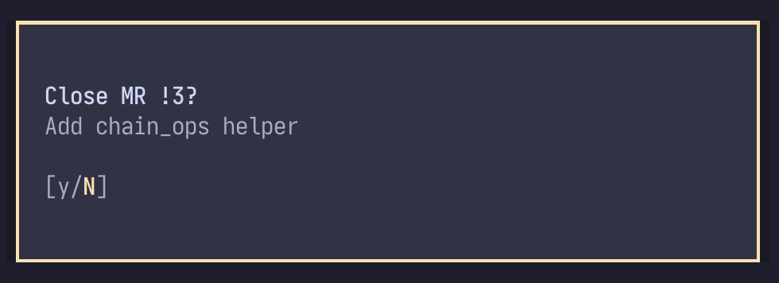

Every write action — merge, close, create tag, rollback, revert — surfaces a `y/N` modal (defaulting to No) before hitting the API.

## Keyboard Shortcuts

Keys are case-sensitive (`R` is not `r`) and each screen only handles the keys listed for it.

### Global

| Key | Action |
|-----|--------|
| `q` | Go back one level (no-op on a home screen) |
| `Esc` / `Ctrl+c` | Quit the app |
| `r` | Refresh current view |
| `y` | Copy URL or content to clipboard |
| `b` | Open current selection in browser |
| `m` / `tab` | Open module switcher (from home screens) |
| `Up/Down` / `j/k` | Navigate |
| `Enter` | Select / drill down |

### My Work (home)

| Key | Action |
|-----|--------|
| `[` / `]` | Cycle panel (Favorites / My Open MRs / My Tag Deploys) |
| `Enter` | Open highlighted repo (hub) or MR (detail) |
| `M` | Full MRs list |
| `P` | My pipelines |

### Project Hub

| Key | Action |
|-----|--------|
| `[` / `]` | Cycle panel (MRs / Pipelines / Commits / Tags) |
| `t` | Cycle commit window: 1d -> 3d -> 7d |
| `C` / `M` / `P` / `T` | Open Commits / MRs / Pipelines / Tags as a full view |
| `Enter` | Open highlighted row |

### Project Picker

| Key | Action |
|-----|--------|
| `/` | Focus search input |
| `s` | Star / unstar current project |
| `a` | Toggle view: Favorites only <-> All projects |
| `c` | Clear filter |
| `g` | Go to MR by project + number |
| `p` | My pipelines |
| `Down` / `Escape` | Move from search to project list |

### Pipeline List View

| Key | Action |
|-----|--------|
| `/` | Focus filter input |
| `t` | Cycle age window: 3d -> 7d -> 30d -> all |
| `s` | Cycle status filter: all -> running -> pending |
| `f` | Toggle failed-only filter |
| `x` | Cancel selected pipeline |
| `c` | Clear filter |
| `M` | This project's MRs |
| `P` | My pipelines |

### Job List View

| Key | Action |
|-----|--------|
| `/` | Focus filter input |
| `s` | Cycle status filter: all -> failed -> running -> pending |
| `f` | Show failed jobs summary |

### Job Detail View

| Key | Action |
|-----|--------|
| `f` | Show failures only (hide full trace) |

### My Pipelines

| Key | Action |
|-----|--------|
| `/` | Focus filter input |
| `t` | Cycle age window: 3d -> 7d -> 30d -> all |
| `c` | Clear filter |
| `a` | Pick a project (opens its Project Hub) |

### Merge Request List

| Key | Action |
|-----|--------|
| `/` | Focus filter input |
| `s` | Cycle state: opened / merged / closed / all |
| `A` | Toggle auto-merge |
| `u` | Assign to a project user |
| `g` | Go to MR by number (My MRs) |
| `w` | Cycle merged/closed window: 1d -> 7d -> 10d (My MRs) |
| `n` | Create / edit local note (My MRs) |
| `e` | Export list to markdown (My MRs) |
| `M` | Merge (My MRs) |
| `p` | Pipelines for selected MR (My MRs) |

### Merge Request Detail

| Key | Action |
|-----|--------|
| `M` | Merge (confirm) |
| `A` | Toggle auto-merge / merge-when-pipeline-succeeds |
| `a` | Approve (confirm) |
| `x` | Close (confirm) |
| `c` | Comment (`ctrl+s` posts) |
| `p` / `k` | Open pipelines / commits |
| `f` | Toggle resolved discussions |
| `e` | Expand / collapse all `<details>` sections in discussions |
| `t` | Toggle auto-refresh |
| `g` | Go to another MR by number |
| `v` | Open the local review file, if one exists |
| `R` | Run an adversarial review for this MR now (re-reviews if one exists) |
| `u` | Assign to a project user (filterable lookup; replaces the current assignee) |

### Reviews

| Key | Action |
|-----|--------|
| `/` | Focus filter input |
| `v` | View the local review (marks it read); inside the viewer `y` copies it, `c` posts it as an MR comment (confirm), `R` re-runs it |
| `R` | Run a review for the selected MR now |
| `T` | Run one poller tick now |
| `P` | Toggle auto-review on/off (confirm) |
| `a` | Approve (confirm) |
| `n` | Create / edit local note |
| `p` | Pipelines for selected MR |

Copying part of a review: click and drag inside the modal to select, then `y` or `ctrl+c` copies the selection (`y` with nothing selected copies the whole review). `ctrl+c` with nothing selected still quits. This applies to any text in glmon, not only reviews. If you want the terminal's own selection instead (Cmd+C), hold Shift while dragging so the terminal keeps the mouse; WezTerm, iTerm2, and kitty all support that.

### Tags

| Key | Action |
|-----|--------|
| `/` | Focus filter input |
| `Enter` | Open pipelines filtered to selected tag |
| `t` | Create + push a new tag |
| `R` | Run selected tag's pipeline (re-run / rollback) |
| `V` | Open a revert MR for the selected tag's commit |

### Commit Browser

| Key | Action |
|-----|--------|
| `/` | Focus filter input |
| `t` | Cycle time window |
| `Enter` | Open commit detail (files + stats) |
| `p` | Open the commit's pipeline |

## Usage Examples

### Basic Workflow
1. Launch with `glmon` (lands on My Work)
2. Press `m` then `2` for the Project Hub picker, search or scroll to your project, press Enter
3. Press `P` to open the project's pipelines and navigate with arrow keys
4. Press Enter to view jobs in a pipeline
5. Press Enter on a job to view its logs
6. Press `q` to go back up a level

### Building a Favorites List
1. Launch `glmon`, press `m` then `2` to open the project picker, then `a` to load all projects
2. Navigate to a project you care about, press `s` to star it
3. Repeat for other projects
4. Next launch: starred projects show up on My Work and load instantly in the picker's default Favorites view

### Jump Straight to a Project
```bash
glmon -p my-group/my-project
```
Skips My Work and the picker, landing on that project's pipelines. Useful for shell aliases or keyboard launchers.

### Loading Older Pipelines
Default view is last 3 days. Press `t` in the pipeline list to expand to 7d, 30d, or all. Or launch with `--days 30` to set a different default.

### Investigating Failures
1. Navigate to a pipeline with failed status (red)
2. Press Enter to see jobs
3. Failed jobs are highlighted in red
4. Press `f` for the failed jobs summary, or `s` to filter the list to failed jobs
5. Press Enter on a failed job to see extracted failures

### Opening in Browser
At any level, press `b` to open the current selection in your browser for full GitLab UI access.

## Status Badges

| Badge | Style |
|-------|-------|
| `success` | Green |
| `failed` | Red |
| `running` | Yellow |
| `pending` | Dim |
| `canceled` | Dim |
| `created` | Dim |
| `manual` | Blue |
| `skipped` | Dim |

## Jira Sync

`glmon-jirad` keeps one Jira ticket per merge request you author, as a side effect of the MR itself. There is no webhook. Each run lists your MRs, works out what the ticket status should be from the MR's current state, and fixes anything that drifted, so a run missed while the laptop slept is caught up by the next one.

For an open MR whose title carries no ticket key, it creates a ticket in `jira.project` (summary is the MR title, description is up to three plain-language bullets written by `claude -p --model haiku`, label `jira.label`, assigned to you, with a link back to the MR), then puts the key in the MR title. A placeholder key such as `PE-0000` is replaced where it sits, so `chore(PE-0000): x` becomes `chore(PE-123): x`; otherwise the key is prefixed as `[PE-123]`. The title is the only place the link lives, and Jira's GitLab integration reads it from there.

Status follows the MR:

| MR state | Ticket status |
|----------|---------------|
| draft, or head pipeline not green | In Progress |
| not draft, head pipeline green (or the project runs no MR CI) | In Review |
| merged | Done |
| closed without merging | Won't fix |

It only ever moves tickets carrying its own label, and only out of a To Do category status or one it set itself. If someone moves a ticket to In QA or In Monitoring by hand, it stays there. A ticket key you put in a title yourself is left alone. MRs under a namespace in `jira.exclude_namespaces` are skipped entirely, and only MRs created after you enable the sync get tickets, so turning it on never backfills.

Config lives in the `jira` block of `~/.config/gitlab-monitor/config.json`:

```json
"jira": {
  "base": "https://your-domain.atlassian.net",
  "email": "you@example.com",
  "project": "PE",
  "exclude_namespaces": ["your.username", "some-group"]
}
```

`JIRA_EMAIL` and `JIRA_TOKEN` (or `JIRA_API_TOKEN`) come from the environment, same names jira-tui uses; `JIRA_BASE` overrides `base`. launchd starts the job with a bare environment, so put the email in the config block too and the token in a file only you can read:

```bash
printf '%s' "$JIRA_API_TOKEN" > ~/.config/gitlab-monitor/jira_token && chmod 600 ~/.config/gitlab-monitor/jira_token
```

Run it by hand:

```bash
glmon-jirad --enable             # turn it on; MRs created from now on get tickets
glmon-jirad --dry-run            # print what would change, write nothing
glmon-jirad --once               # one run (the default)
glmon-jirad --mr group/project!123 --summary-file bullets.md   # sync one MR now, with your own bullets
glmon-jirad --status
glmon-jirad --disable
```

To check on a ticket, `glmon-jirad --lookup` reads the current checkout's GitLab remote and branch, finds the MR, and prints the ticket, its status, and whether it matches what the MR says it should be. Pass a branch name, an MR URL, or `group/project!123` to look elsewhere. It only reads, and works while the sync is disabled.

```
$ glmon-jirad --lookup
PE-1601  In Review  feat(admin): show stored session record on detail  https://your-domain.atlassian.net/browse/PE-1601
identity/recharge-auth!77  opened  pipeline success  expects In Review: in sync
```

Schedule it the same way as the review poller:

```bash
cp launchd/com.bryan.glmon-jirad.plist ~/Library/LaunchAgents/
launchctl load ~/Library/LaunchAgents/com.bryan.glmon-jirad.plist
tail -f ~/.cache/glmon/jirad.err
```

## Architecture

```
PipelineMonitor (App)
    ├── LoadingScreen (splash while connecting)
    ├── MyWorkScreen (home — favorites, my open MRs, tag deploys)
    │   ├── ProjectHubScreen (MRs / pipelines / commits / tags panels)
    │   └── MergeRequestDetailScreen
    ├── ProjectSelectScreen (project picker)
    │   └── PipelineListScreen (auto-refresh 2m)
    │       └── JobListScreen (auto-refresh 2m)
    │           ├── JobDetailScreen (auto-refresh 5s) — info bar + trace/failures
    │           └── FailedJobsScreen
    ├── MyMergeRequestsScreen / ProjectMergeRequestsScreen / MyReviewsScreen
    │   └── MergeRequestDetailScreen — merge / approve / close / comment
    │       ├── MRPipelineListScreen
    │       └── MRCommitListScreen
    ├── TagListScreen — create / rollback (run pipeline) / revert MR
    ├── CommitListScreen → CommitDetailScreen
    └── MyPipelineListScreen
```

Screens dispatch keys via a per-screen `KEY_MAP` (case-sensitive) rather than Textual `BINDINGS`. `GitLabAPI` (`api.py`) wraps every python-gitlab call.

`reviewd.py` is the Reviews poller, installed as the `glmon-reviewd` console script. It shares `Config`, `GitLabAPI`, and the `ReviewFiles` index (`config.py`) with the TUI; the two processes talk only through the review files on disk.

`jirad.py` is the Jira sync, installed as `glmon-jirad`. It reuses `Config`, `GitLabAPI`, and reviewd's lock and claude helpers, and talks to Jira's REST API with the standard library. The TUI knows nothing about Jira.

## Files

| Path | Purpose |
|------|---------|
| `~/.config/gitlab-monitor/config.json` | Optional non-token config (url, project, reviews) |
| `~/.config/gitlab-monitor/token` | Optional 0600 token file, read only when `GITLAB_TOKEN` is unset (launchd poller) |
| `~/.config/gitlab-monitor/favorites.json` | List of starred project paths |
| `~/.config/gitlab-monitor/mr_notes.json` | Local per-MR notes |
| `~/.config/gitlab-monitor/last_view.json` | Last view per module; written as you navigate, but not restored (glmon always opens on My Work) |
| `~/dev/reviews/` (or `reviews.dir`) | Local AI review files, one markdown file per MR; `_locks/` holds per-MR lockfiles while a review runs |
| `~/.cache/glmon/reviewd.{out,err}` | launchd poller logs; `reviewd-manual.log` for reviews started from the TUI |
| `~/Library/LaunchAgents/com.bryan.glmon-reviewd.plist` | Poller schedule (copied from `launchd/` in this repo) |
| `~/.config/gitlab-monitor/jira_token` | Optional 0600 Jira API token, read only when `JIRA_TOKEN` and `JIRA_API_TOKEN` are unset (launchd sync) |
| `~/.cache/glmon/jirad-state.json` | Last ticket status the sync applied per MR, so unchanged MRs cost no Jira calls |
| `~/.cache/glmon/jirad.{out,err}` | launchd Jira sync logs |
| `~/Library/LaunchAgents/com.bryan.glmon-jirad.plist` | Jira sync schedule (copied from `launchd/` in this repo) |

## Screenshots

All screenshots come from a synthetic gitlab.com demo project so no real work data is shown. See [`DEVELOPMENT.md`](DEVELOPMENT.md) for the demo repo URL, bootstrap steps, and screenshot capture conventions.

## Future Enhancements

- [ ] Search within logs
- [ ] Pipeline trends/statistics view
- [ ] Notification on failure
